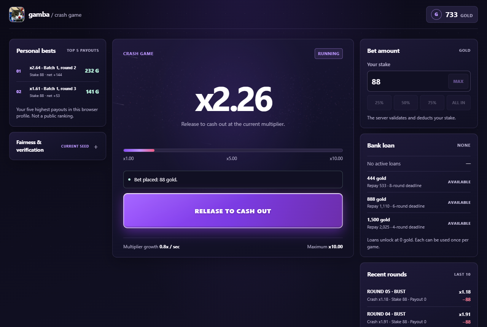

# gamba

**[Play the game](https://elajeff.github.io/gamba-game/)**

A browser crash game. Hold to start a round, watch the multiplier climb, and release before it crashes. You play with in-game gold (888 to start, plus optional loans); there is no real money involved.

The frontend is plain JavaScript on GitHub Pages. The backend is a Cloudflare Worker with one SQLite-backed Durable Object per player session. The server decides every outcome and payout, and the browser only handles input and display. Once a seed is revealed, each of its rounds can be checked against the commitment published before they started.



## How it works

- Each session's Durable Object holds the balance, loans and rounds. Wallet changes run in SQLite transactions, and alarms settle a round if the browser disconnects.
- Start, release, cash-out, loan, reset and end-game requests carry an idempotency key, so a retry can't charge twice.
- A start reservation stops a second round opening while the first is still starting. A release that arrives during startup is recorded and applied once the round exists.
- The browser sends the multiplier it showed when you released. The server checks its own clock against the committed crash point first, then pays the lower of the two values. A release that arrives after the crash still loses.
- Settlement is pushed over a WebSocket. During a round the browser also polls the round status, once a second while the socket is open and every 250 ms while it is down, and stops while the tab is hidden.
- Each server seed is published as a SHA-256 commitment before use and revealed when it rotates (see below).

[docs/architecture.md](docs/architecture.md) describes what each source file does and the rules the game logic follows.

## How the crash point is calculated

For each round the server computes an HMAC-SHA-256 digest from the server seed, client seed and round nonce, and takes the first 52 bits:

```text
digest = HMAC-SHA-256(serverSeed, clientSeed:nonce)
r = integer represented by the first 52 digest bits
D = 2^52
crashCents = max(100, floor((100 - e) * D / (D - r)))
crashMultiplier = crashCents / 100
```

`e` is the house edge in percentage points (`1` means 1%). The result is rounded down to cents and is never below `x1.00`. Cash-outs are capped at `x10`, and the crash point itself at `x1,000,000`. The same seed, nonce and edge always give the same result.

Unrevealed seeds are stored encrypted with AES-256-GCM. The crash point is never sent while a round is running.

## Checking past rounds

Save the `seeds` and `rounds` arrays from your session's `/api/fairness` responses to a JSON file, then run:

```sh
node tools/verify-fairness.js fairness-export.json
```

The script recomputes the commitments and crash points with Node's own crypto module rather than importing the Worker code, and reports each record as verified, pending or mismatched. See [docs/fairness-verification.md](docs/fairness-verification.md) for the file format.

## Run locally

You need Node.js 22+ and Python 3. Serve the frontend from the repository root:

```powershell
py -m http.server 5500
```

Open `http://localhost:5500` (not a `file://` URL). By default it talks to the deployed Worker set in `backend-config.js`; that URL is public, not a secret.

To run the Worker locally as well, create `backend/.dev.vars` with development secrets as shown in [backend/README.md](backend/README.md), then:

```powershell
cd backend
npm.cmd ci
npm.cmd run dev
```

and point `backend-config.js` at `http://localhost:8788` while you test.

## Tests

```powershell
cd backend
npm.cmd ci
npm.cmd test
```

This runs the backend tests in `backend/test/` and the frontend module tests in `tests/frontend/`. They cover the crash formula, malformed requests, authentication, duplicate and concurrent requests, loans, alarms and WebSocket push. The integration tests start a local Worker with test-only secrets and never touch the deployed one. GitHub Actions runs the same suite on every push and pull request.

## Deploy

The Worker is deployed with Wrangler and the frontend is served by GitHub Pages from the repository root. The secrets and the steps are in [backend/README.md](backend/README.md#deploy).

## Limitations

- The fairness check proves that the published records match their commitments. It can't prove that no round was left out of the history or that the deployed code never changed.
- The multiplier on screen is an estimate from the server's start time; network delay can make the crash notice arrive late.
- Sessions are anonymous and live in one browser profile. They don't sync between devices.
- There is no rate limiting, so heavy automated traffic could use up the Cloudflare free-tier quota. See [SECURITY.md](SECURITY.md).

## License

MIT. See [LICENSE](LICENSE).
